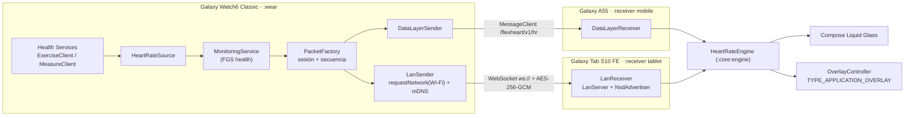

# Arquitectura

## Estado del repositorio al empezar (FASE 0)

El repositorio `AccountDev-Design/Flex-Health-` estaba **vacío**: sin commits, sin ramas remotas y sin código
de Flex Health. No había arquitectura previa que respetar ni funcionalidades que conservar, por lo que se creó
una estructura Gradle multi-módulo desde cero, pensada para crecer dentro del ecosistema Flex Health.

## Vista general



Ambos receptores son **la misma app** (`:receiver`) con dos *flavors*: `mobile` (applicationId
`com.flexhealth.heartmonitor`, idéntico al del reloj para Data Layer) y `tablet`
(`com.flexhealth.heartmonitor.tablet`). Cada *flavor* define su modo por defecto y puede usar el otro modo.

## Módulos

```
core/protocol   (JVM)      HeartRatePacket, SensorStatus, LanMessage, PacketValidator,
                           crypto/: HKDF, ECDH P-256, Pairing*, SessionKeys, SecureChannel
core/engine     (JVM)      HeartRateEngine, SampleRingBuffer, SequenceTracker, ClockSync,
                           FreshnessPolicy, SparklineLayout
core/lan        (JVM)      LanServer (Java-WebSocket), LanLink + pairWithReceiver (OkHttp)
core/android    (Android)  KeystorePairingStore, NsdAdvertiser, NsdBrowser, DeviceIdentity
wear            (Wear OS)  sensor/, service/, transport/, settings/, ui/
receiver        (Android)  data/, transport/, service/, overlay/, ui/{theme,glass,components,screens}
```

Los tres módulos `core` JVM no dependen de Android: el protocolo, la criptografía, el motor y el transporte
Wi-Fi se prueban en la JVM, incluida una conexión WebSocket real por TCP (loopback).

## Reloj (`:wear`)

- **`HeartRateSource`** (abstracción): flujo frío de `SensorEvent.Reading` / `SensorEvent.Status`. Nunca
  emite lecturas sintéticas. Implementaciones:
  - `ExerciseHeartRateSource` — Health Services **ExerciseClient** (por defecto). Monitorización continua
    también con la pantalla apagada; pide `BatchingMode.HEART_RATE_5_SECONDS` si el dispositivo lo soporta.
    No interrumpe un ejercicio de otra app (Samsung Health) salvo confirmación explícita del usuario.
  - `MeasureHeartRateSource` — Health Services **MeasureClient**: datos rápidos solo con la app visible.
  - *Samsung Health Sensor SDK*: **no incluido** (requiere AAR descargado y autorización; ver
    DEVICE_COMPATIBILITY.md). La abstracción permite añadirlo sin tocar servicio, transportes ni UI.
- **`MonitoringService`**: servicio en primer plano `foregroundServiceType="health"`, una única sesión
  (las llamadas repetidas se ignoran), Ongoing Activity, *wake lock* opcional con límite de 4 h
  («Baja latencia», desactivado por defecto) y latido de **estado** cada 2 s sin lecturas (nunca un BPM).
- **Hilos:** toda la sesión (Keystore, JSON, AES-GCM, envíos) se ejecuta en `Dispatchers.Default`; el hilo
  principal del reloj solo dibuja. La UI observa un modelo reducido (`MonitorUi`) que no cambia con RTT,
  detalles ni contadores, y oculta el BPM con un único temporizador en lugar de un bucle de 1 Hz.
- **Transportes** en paralelo según ajustes: `DataLayerSender` (CapabilityClient + MessageClient) y
  `LanSender` (red Wi-Fi solicitada con `requestNetwork`, socket atado a esa red, mDNS o última IP
  conocida, `LanLink` con reconexión exponencial 1→15 s).

## Receptor (`:receiver`)

- **`MonitorService`**: servicio en primer plano `connectedDevice`. Mantiene el transporte activo, el motor
  y el overlay; la app principal puede cerrarse. Cambiar de modo reinicia transporte y sesión.
- **`HeartRateEngine`** (compartido): valida, deduplica, detecta desorden y pérdidas, estima el desfase de
  relojes (mínimo deslizante de recepción − medición), marca lecturas atrasadas (≥ 2,5 s), guarda el
  historial en un búfer circular de capacidad fija (1024 muestras, ≤ 120 s) y calcula la actualidad
  `LIVE` (< 3 s) · `STALE` (3–5 s) · `LOST` (≥ 5 s) con un temporizador que solo despierta en la siguiente
  transición (sin sondeo).
- **Overlay**: `OverlayController` (WindowManager) + `OverlayWidgetView` (Canvas puro, sin Compose) +
  `OverlayMenuView`. Geometría pura en `OverlayGeometry` (probada en JVM).
- **UI**: Compose Material 3 con un sistema propio *Liquid Glass* (`ui/glass`): el fondo se redibuja
  recortado y desenfocado (`RenderEffect`, API 31+) bajo cada superficie, con tinte, reflejo y borde
  degradado. Componentes reutilizables en `ui/components`; pantallas separadas en `ui/screens`; navegación
  adaptable (barra inferior en móvil, raíl lateral en tablet ≥ 600 dp).

## Decisiones principales

| Decisión | Motivo |
|---|---|
| Health Services ExerciseClient como fuente por defecto | API oficial de Wear OS para FC continua con pantalla apagada; no requiere autorización de Samsung. |
| Data Layer para el teléfono, sin GATT propio | Es el mecanismo oficial reloj↔teléfono emparejado. Un servidor GATT propio duplicaría la conexión Bluetooth que Wear OS ya gestiona y no aporta nada al requisito (ver KNOWN_LIMITATIONS.md). |
| WebSocket + cifrado de aplicación (no TLS) en LAN | TLS exigiría certificados/PKI en una red local sin Internet. Se usa ECDH P-256 + comparación numérica + AES-256-GCM (CONNECTION_PROTOCOL.md). |
| P-256 en lugar de X25519 | Disponible en todas las versiones Android soportadas (API 30+) y en la JVM de pruebas. |
| Overlay en `View` nativa | Coste por fotograma mínimo y sin bucle continuo: se redibuja con cada muestra (≈1 Hz) y 450 ms de animación. |
| Sin Haze ni librerías de blur | Haze 2.x separa el desenfoque en otro artefacto con API no verificable aquí; el vidrio propio usa solo APIs de plataforma/Compose. |
| targetSdk 36, compileSdk 37 | Las AndroidX actuales exigen compilar con 37; el comportamiento verificado/documentado es el de API 36 (Wear OS 6). |
| Inyección manual de dependencias | Grafo pequeño; evita frameworks y procesadores de anotaciones. |
