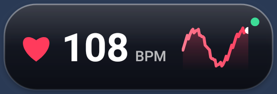
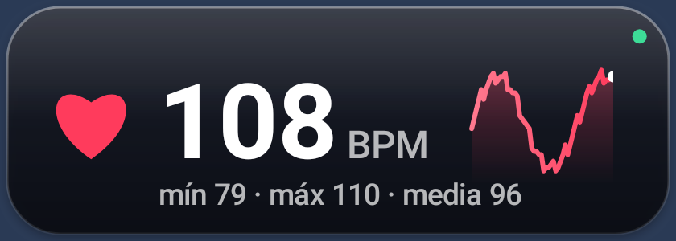
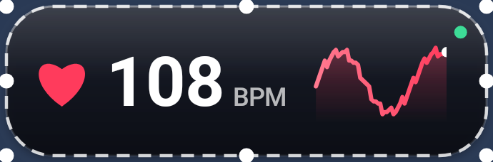
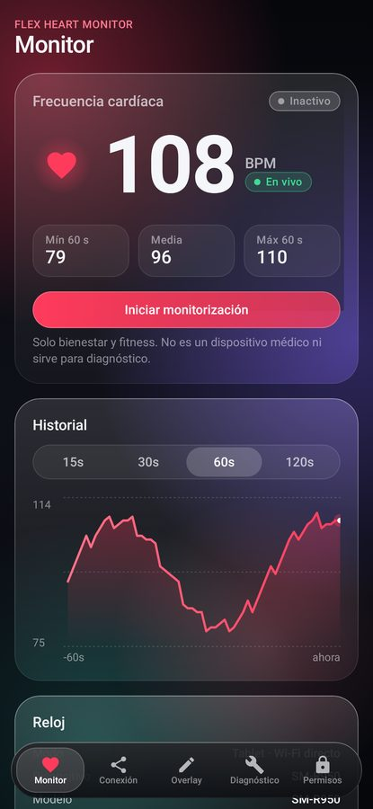
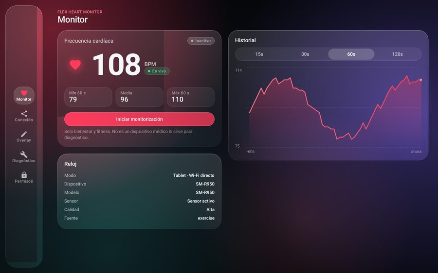

# Flex Heart Monitor

Monitorización de frecuencia cardíaca en tiempo real desde un **Samsung Galaxy Watch6 Classic (SM-R950)**,
con una ventana flotante **Liquid Glass** compacta, movible y redimensionable que se superpone a otras apps
Android (por ejemplo Geometry Dash).

> ⚠️ **Bienestar y fitness únicamente.** Flex Heart Monitor no es un dispositivo médico y no debe usarse para diagnóstico.

| Overlay compacto (190 × 65 dp) | Overlay grande (280 × 100 dp) | Modo edición (redimensionar) |
|---|---|---|
|  |  |  |

| App en smartphone | App en tablet |
|---|---|
|  |  |

*Capturas renderizadas en la JVM con Robolectric (gráficos nativos), alimentadas con paquetes de prueba
inyectados **solo en el test**. El renderizador no aplica el desenfoque `RenderEffect`; en un dispositivo con
Android 12+ las tarjetas muestran además el fondo desenfocado.*

## Componentes

| Componente | Módulo | Dispositivo | Transporte |
|---|---|---|---|
| **Flex Heart Watch** | `:wear` | Galaxy Watch6 Classic SM-R950 (Wear OS) | Emisor |
| **Flex Heart Monitor Mobile** | `:receiver` (*flavor* `mobile`) | Galaxy A55 5G | Wear Data Layer (Bluetooth cuando el reloj está cerca) |
| **Flex Heart Monitor Tablet** | `:receiver` (*flavor* `tablet`) | Galaxy Tab S10 FE | **Flex Link Dual**, a elegir: WebSocket cifrado por Wi-Fi local **o** Bluetooth LE directo (GATT). Ambos sin teléfono ni Internet |

Código compartido (sin duplicación):

| Módulo | Tipo | Contenido |
|---|---|---|
| `:core:protocol` | Kotlin/JVM | Modelo serializable versionado, validación, criptografía de emparejamiento y sesión |
| `:core:engine` | Kotlin/JVM | Motor de datos: búfer circular, secuencias, desfase de relojes, actualidad (3 s / 5 s), geometría de gráfica |
| `:core:lan` | Kotlin/JVM | Servidor WebSocket (Java-WebSocket) y cliente con reconexión (OkHttp) |
| `:core:android` | Android library | Almacén de emparejamientos con Android Keystore, mDNS (NSD), identidad de instalación |

## Compilar

Requisitos: JDK 17+ (probado con JDK 21), Android SDK con **platform 37** y build-tools 36.

```bash
echo "sdk.dir=/ruta/a/Android/sdk" > local.properties
./gradlew assembleDebug        # wear-debug.apk, receiver-mobile-debug.apk, receiver-tablet-debug.apk
./gradlew test                 # pruebas JVM + Robolectric
./gradlew :wear:lintDebug :receiver:lintMobileDebug :receiver:lintTabletDebug
```

> **Rendimiento:** para usar o medir la app instala las APK **release** (`*-release.apk`: R8, sin depuración,
> con perfiles de referencia). Las *debug* son mucho más lentas en el reloj (ver ARCHITECTURE.md › Rendimiento).
> Si no configuras un keystore propio (`flexheart.storeFile`, `flexheart.storePassword`, `flexheart.keyAlias`,
> `flexheart.keyPassword` en `~/.gradle/gradle.properties`), release se firma con tu clave de depuración local.
>
> **Importante:** compila el reloj y el móvil **en la misma máquina** (mismo keystore de depuración).
> Wear Data Layer solo entrega mensajes entre apps con el **mismo applicationId y la misma firma**.

Instalación y pruebas paso a paso: [TESTING.md](TESTING.md).

## Documentación

- [ARCHITECTURE.md](ARCHITECTURE.md) — arquitectura, módulos, flujo de datos, decisiones.
- [DEVELOPMENT_PLAN.md](DEVELOPMENT_PLAN.md) — fases 0–11 y su estado real.
- [DEVICE_COMPATIBILITY.md](DEVICE_COMPATIBILITY.md) — dispositivos, versiones, APIs del sensor, permisos.
- [CONNECTION_PROTOCOL.md](CONNECTION_PROTOCOL.md) — protocolo v1, emparejamiento y seguridad.
- [TESTING.md](TESTING.md) — pruebas automatizadas, pruebas pendientes en hardware, instalación.
- [KNOWN_LIMITATIONS.md](KNOWN_LIMITATIONS.md) — límites de Android/Wear OS/Samsung y bloqueos.

## Privacidad

- La FC solo viaja entre el reloj y tus dispositivos emparejados; nunca a servidores propios ni a Internet
  (en modo smartphone, Wear Data Layer puede enrutar por servidores de Google cifrados extremo a extremo si no
  hay Bluetooth; se indica en pantalla con «Conexión directa»).
- El historial vive en memoria y se borra al detener la monitorización. No se guardan datos de salud.
- No se lee nada de Samsung Health. Los permisos se piden solo cuando hacen falta y con explicación.
